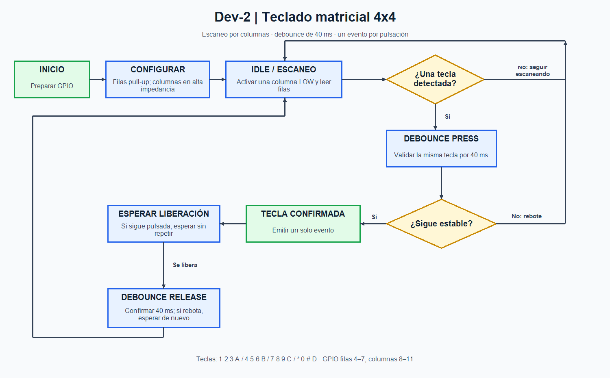
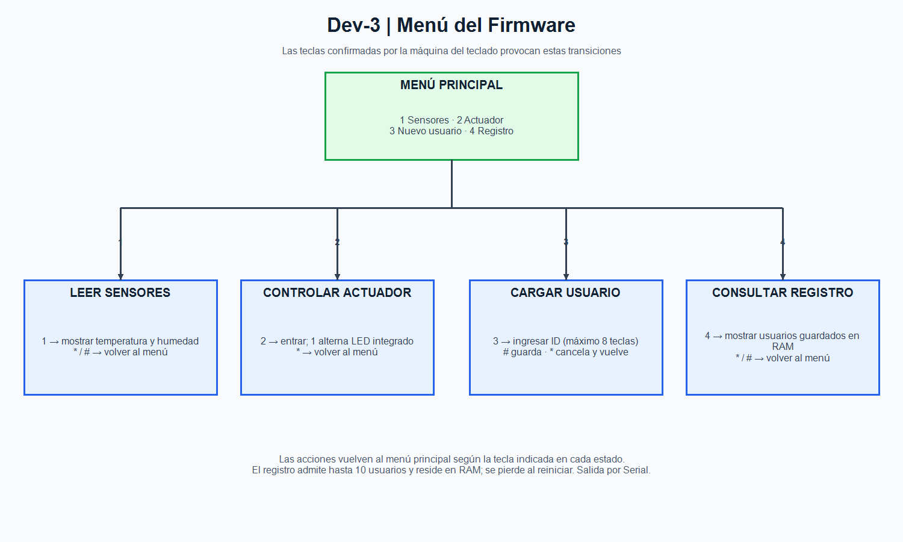

# Máquinas de estado del Firmware

## Dev-2: teclado matricial 4x4



El Firmware escanea una columna por vez. Las filas usan `INPUT_PULLUP`; una tecla
única se confirma después de 40 ms estable. Se genera un evento una sola vez por
pulsación y se espera una liberación también estable por 40 ms antes de rearmar
el escaneo. Si hay varias teclas detectadas simultáneamente, se ignora la lectura.

La distribución es la convencional:

```text
1 2 3 A
4 5 6 B
7 8 9 C
* 0 # D
```

| Señal | GPIO ESP32-S3 |
| --- | --- |
| Filas 1–4 | 4, 5, 6, 7 |
| Columnas 1–4 | 8, 9, 10, 11 |

Conectar filas con resistencias pull-up internas y columnas conmutadas a LOW por
el escáner. Ajustar los pines en `Firmware/src/Keypad.cpp` si el cableado del
prototipo usa otra distribución.

## Dev-3: menú del Firmware



`menuUpdate` recibe eventos de tecla confirmados por la máquina del teclado:

| Estado/tecla | Comportamiento |
| --- | --- |
| Principal + `1` | Lee y muestra temperatura y humedad |
| Principal + `2` | Abre control del LED integrado |
| Control + `1` | Alterna el LED integrado |
| Principal + `3` | Recibe un ID de hasta 8 teclas; `#` guarda y `*` cancela |
| Principal + `4` | Muestra el registro de usuarios |
| Lecturas/registro + `*` o `#` | Regresa al menú principal |

El registro admite hasta 10 usuarios, evita IDs duplicados y se mantiene en RAM;
no persiste después de reiniciar. La salida del menú se muestra por `Serial`.

## Casos de prueba manuales

1. Pulsar y mantener `1`: debe aparecer un único evento y una lectura de sensores.
2. Sin liberar la tecla, esperar varios ciclos: no debe repetirse el evento.
3. Soltar `1` y pulsarla de nuevo: debe generarse un nuevo evento tras debounce.
4. Desde el menú principal, pulsar `2`, luego `1` dos veces: el LED debe alternar
   encendido y apagado; `*` vuelve al menú.
5. Pulsar `3`, introducir un ID y `#`; entrar a `4` y verificar que aparece.
6. Volver a registrar el mismo ID: debe rechazarse como duplicado.
7. Cancelar un alta con `*` y volver al menú principal.
